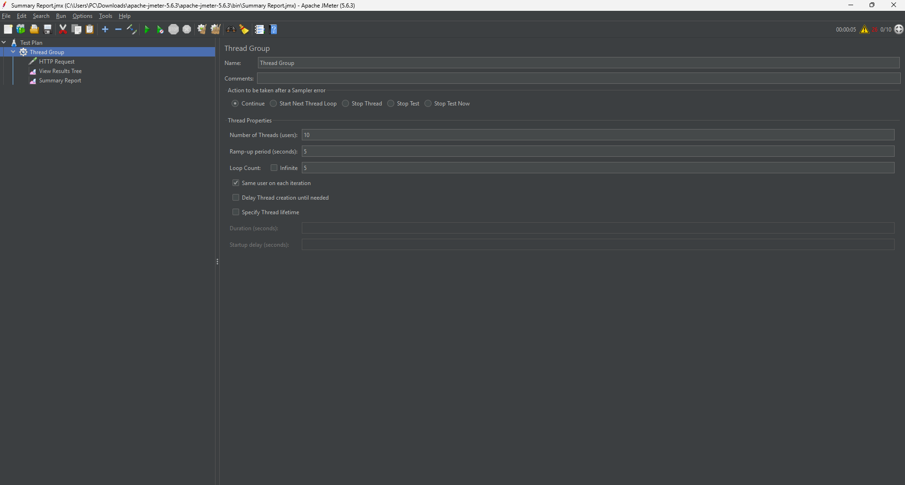

# Apache JMeter Performance Testing

## 1. Introduction

Apache JMeter is an open-source tool used for performance testing, load testing, and functional testing of web applications and APIs.

This project demonstrates how to use Apache JMeter to test a REST API by sending HTTP requests and analyzing performance results.

## 2. Objectives

- Learn the basic features of Apache JMeter.
- Create and configure a test plan.
- Perform HTTP request testing.
- Analyze response time, throughput, and error rate.
- Capture screenshots to document the testing process.

## 3. Tools and Technologies

- **Apache JMeter:** 5.6.3
- **Programming Environment:** Java JDK
- **Operating System:** Windows
- **Testing Tool:** Apache JMeter
- **Test API:** JSONPlaceholder

## 4. Test Environment and Configuration

The API used for testing is:

`https://jsonplaceholder.typicode.com/posts/1`

The HTTP request was configured as follows:

| Configuration | Value |
|---|---|
| Protocol | HTTPS |
| Server Name | `jsonplaceholder.typicode.com` |
| Method | GET |
| Path | `/posts/1` |
| Number of Threads | 10 |
| Ramp-up Period | 5 seconds |
| Loop Count | 5 |

The test simulated 10 virtual users, with each user sending 5 requests. The expected total number of requests was 50.

## 5. Test Procedure

1. Install Java JDK and Apache JMeter.
2. Open Apache JMeter and create a new Test Plan.
3. Add and configure a Thread Group.
4. Add an HTTP Request sampler.
5. Add the View Results Tree listener.
6. Add the Summary Report listener.
7. Run the test and check the request results.
8. Analyze the performance statistics.
9. Save the test plan and screenshots.

## 6. Test Results

### 6.1 Thread Group Configuration

The Thread Group was configured with 10 virtual users, a ramp-up period of 5 seconds, and a loop count of 5.



### 6.2 HTTP Request Configuration

The HTTP Request sampler sent a GET request to the JSONPlaceholder API endpoint `/posts/1`.


### 6.3 View Results Tree

The View Results Tree listener was used to inspect individual requests and their responses. The inspected request returned HTTP status code 200 (OK).


### 6.4 Summary Report

The Summary Report displays the overall performance statistics collected during the test.


### 6.5 Performance Analysis

The test was executed with 10 virtual users, a ramp-up period of 5 seconds, and 5 iterations per user.

The results are summarized below:

| Metric | Result |
|---|---:|
| Total Samples | 50 |
| Average Response Time | 107 ms |
| Minimum Response Time | 30 ms |
| Maximum Response Time | 1,170 ms |
| Standard Deviation | 191.27 ms |
| Error Percentage | 0.00% |
| Throughput | 9.8 requests/second |

**Analysis:**

- All 50 HTTP requests completed without errors during this test.
- The average response time was 107 ms.
- The minimum response time was 30 ms, while the maximum was 1,170 ms.
- The error percentage was 0.00%, meaning no request failures were recorded in this test.
- The throughput was approximately 9.8 requests per second.

The results indicate that the API responded successfully under the configured test conditions. However, response times varied. Additional tests with higher numbers of virtual users would be needed to evaluate performance under heavier workloads.

## 7. Conclusion

This project provided practical experience with Apache JMeter for API performance testing. A test plan was created, HTTP requests were executed, and performance metrics were collected and analyzed.

The test recorded a 0.00% error rate across 50 requests, with an average response time of 107 ms. The experiment demonstrates the basic process of API performance testing. Further tests would be required to assess performance under higher loads.

## 8. Project Structure

```text
jmeter-performance-testing/
├── README.md
├── test-plans/
│   └── api-test.jmx
└── screenshots/
    ├── 01-thread-group.png
    ├── 02-http-request.png
    ├── 03-view-results.png
    └── 04-summary-report.png
```

## 9. References

- [Apache JMeter Official Website](https://jmeter.apache.org/)
- [Apache JMeter User Manual](https://jmeter.apache.org/usermanual/)
- [JSONPlaceholder](https://jsonplaceholder.typicode.com/)
